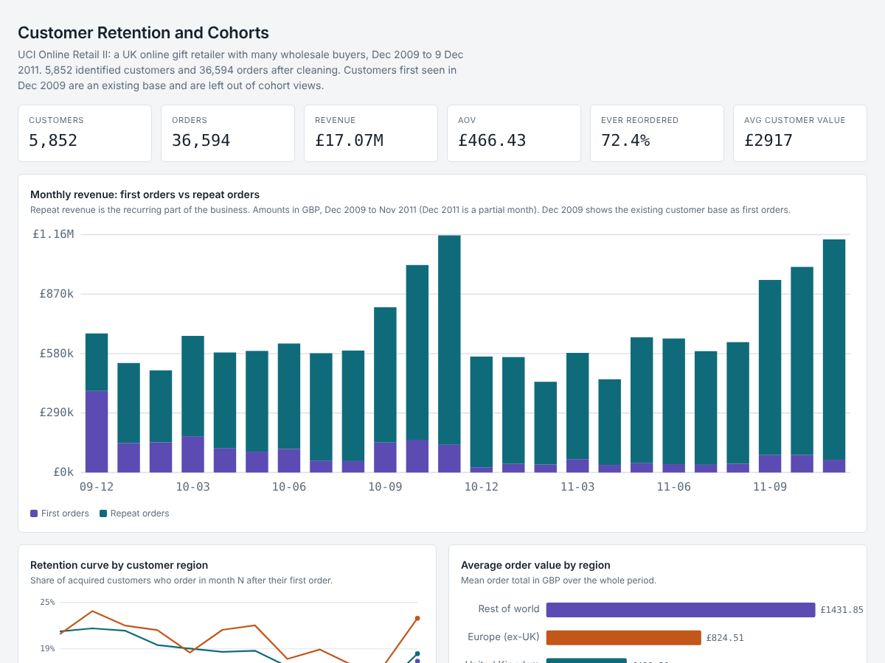
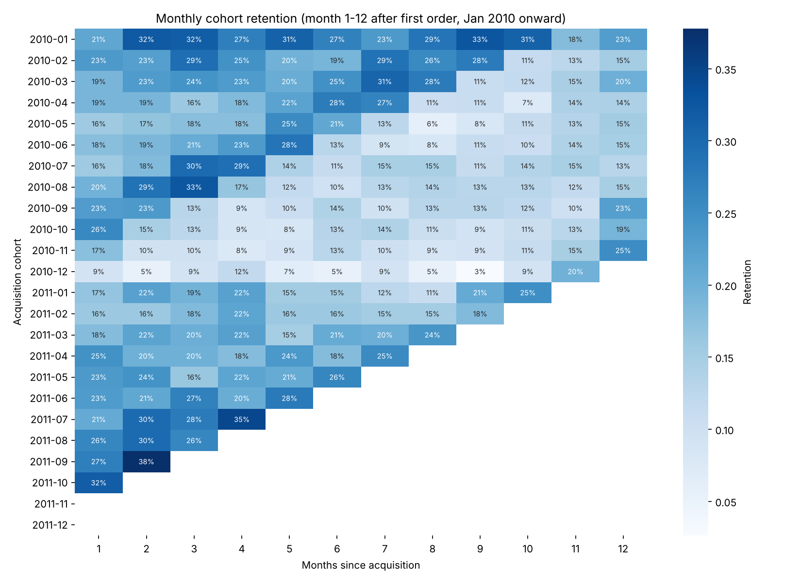

# Project 1: Customer Retention and Cohort Analysis

**Question:** Where do customers drop off after acquisition, and what drives repeat purchases and lifetime value?

**Data:** UCI Online Retail II, a UK online gift retailer (many wholesale buyers), 1 Dec 2009 to 9 Dec 2011.

## Dashboard


Live version: https://rand-al-khdhairawi.github.io/data-analytics-portfolio/retention/



## How to run (Windows)
1. Put `online_retail_II.csv` in `data\` (see `data\README.md`).
2. Open a terminal in this folder, with the virtual environment active (see the repository README).
3. Run the steps in order:
```
python 01_load_clean.py data\online_retail_II.csv data\retail.db
python 02_build_views.py
python 03_analysis.py
python 04_build_dashboard.py
```
Results land in `outputs\` and `images\`. `outputs\dashboard.html` opens in any browser.

## Files
- `01_load_clean.py`: cleans the raw lines and loads SQLite tables.
- `02_models.sql`: SQL views (CTEs, `ROW_NUMBER()`, `LAG()`, month truncation). `02_build_views.py` runs it.
- `03_analysis.py`: RFM segmentation, retention heatmap, regional and product-family analysis.
- `04_build_dashboard.py` and `dashboard_template.html`: the dashboard.

## Cleaning decisions
| Step | Rows affected |
|---|---|
| Raw rows | 1,067,371 |
| Cancellation invoices (start with C) removed | 19,494 |
| Rows with no Customer ID removed (cannot be tracked) | 236,121 |
| Non-product codes (postage, manual, bank charges) removed | by 5-digit stock code rule |
| Clean line items | 776,577 (5,852 customers, 36,594 orders) |

## Method notes
- Customers first seen in Dec 2009 are an existing base. They are excluded from acquisition cohorts and first-order analysis but kept in RFM.
- Dec 2011 is a partial month and is excluded from revenue and cohort views.
- Repeat rates use a fixed 90-day window on customers with at least 90 days of history, so late acquisitions are not penalised.
- The dataset has no acquisition channel. Customer region (UK, Europe ex-UK, Rest of world) replaces it. Rest of world has only 65 customers.
- The dataset has no product category. "Product family" is derived by keyword matching on item descriptions and is approximate.
- "MRR" is approximated as monthly revenue split into first-order and repeat-order revenue.

## Findings
- 72% of identified customers place a second order, but 28% never do (1,380 Hibernating customers, about GBP 345 each).
- Median time to second order is 57 days, and 63% of second orders come within 90 days.
- Champions are 27% of customers and 70% of revenue (about GBP 7,570 each). Champions plus Loyal are 83% of revenue.
- Europe ex-UK: 48% 90-day repeat and AOV GBP 825, vs UK 43% and GBP 428. Based on 453 customers, so treat as a lead.
- First-order product family has a small effect: 90-day repeat ranges from 34% (Christmas) to 46% (Bags and Storage). Christmas customers return fastest (23 days) because buying is seasonal.

## Recommendations
1. Contact new customers inside 60 days of the first order.
2. Protect the Champions and Loyal group with account-level service, since they carry most of the revenue.
3. Test targeted acquisition in Europe outside the UK.
