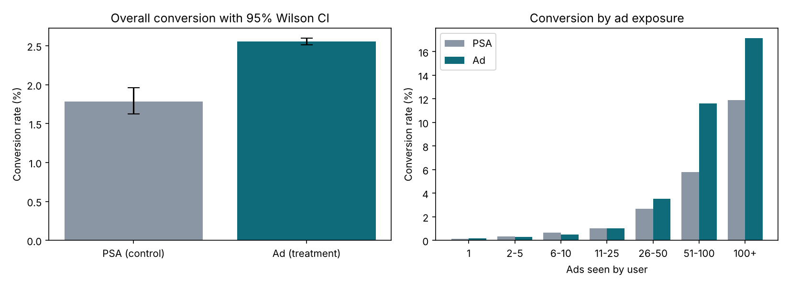

# Project 2: A/B Testing and Product Experimentation Framework

**Question:** Did the ad campaign improve conversion, or is the difference noise?

**Data:** Kaggle Marketing A/B Testing, 588,101 users. Group `ad` (treatment, 564,577) vs `psa` (control, 23,524). Columns: converted, total ads seen, day and hour of heaviest exposure. There is no revenue column, so the skewed metric tested with Mann-Whitney is total ads seen, not spend per user.

## Decision memo
Read [decision_memo.md](decision_memo.md) for the one-page recommendation.



## Files
- `ab_lib.py`: tests and helpers in NumPy and SciPy (z-test, chi-square, confidence intervals, power, minimum detectable effect, logistic regression, Mantel-Haenszel, Holm correction).
- `test_ab_lib.py`: 7 unit tests.
- `run_analysis.py`: the full analysis. Writes `results.json` and `ab_overview.png`.
- `app.py`: Streamlit app (results explorer and sample-size calculator).

## How to run (Windows)
1. Put `marketing_AB.csv` in `data\` (see `data\README.md`).
2. Open a terminal in this folder, with the virtual environment active (see the repository README).
```
python run_analysis.py data\marketing_AB.csv .
python -m pytest -q
streamlit run app.py
```

## Headline result
Ad 2.55% vs PSA 1.79%: +0.77 pp (95% CI +0.60 to +0.94), +43% relative (CI +30% to +58%), z = 7.37, p = 1.7e-13. Recommendation: roll out, with a revenue check first.

## Things to know
- The split is exactly 96/4. The sample ratio test passes against that design, but the intended ratio is not documented in the data.
- Lift is concentrated among users who saw more than 25 ads. Below that there is no measurable difference. Exposure is measured after assignment, so this is descriptive, not causal.
- Day, hour and ads-seen are post-assignment variables, so balance on them is only a rough check. Differences are statistically detectable but small (Cramér's V 0.02 and 0.013).
- The logistic regression is a NumPy Newton-Raphson implementation checked against simulated data. It has not been cross-checked against statsmodels.
- `app.py` was syntax-checked but has not been launched. Run `streamlit run app.py` and check it before relying on it.
