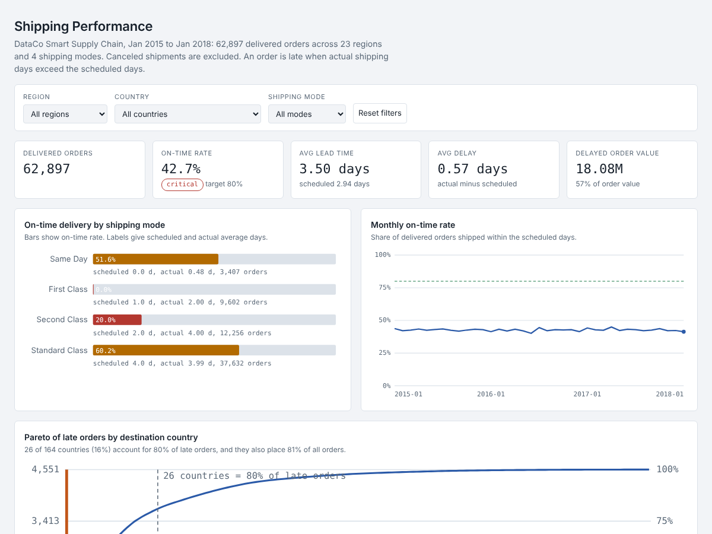

# Project 3: Supply Chain and Logistics Performance

**Question:** Which destinations and carrier service levels cause recurring delivery delays, and how does lead-time variance affect the on-time target?

**Data:** DataCo Smart Supply Chain, 180,519 order lines, 62,897 delivered orders, Jan 2015 to Jan 2018. Customer names, emails, passwords, streets and zip codes are dropped when building the model.

## Dashboard


Live version: https://YOUR-USERNAME.github.io/data-analytics-portfolio/supply-chain/

## How to run (Windows)
1. Put `DataCoSupplyChainDataset.csv` in `data\` (see `data\README.md`).
2. Open a terminal in this folder, with the virtual environment active (see the repository README).
3. Run the steps in order:
```
python 01_build_star.py data\DataCoSupplyChainDataset.csv data\supply.db
python 02_build_views.py
python 03_analysis.py data\supply.db outputs
python 04_build_dashboard.py
```

## Files
- `01_build_star.py`: builds the star schema in SQLite: `Fact_Shipments` plus `Dim_Date`, `Dim_Route`, `Dim_ShippingMode`, `Dim_Product`, `Dim_Customer`. Assertions check that the late flag matches the source. Personal columns are dropped.
- `02_kpis.sql`: KPI views with window functions for share of late orders and the cumulative Pareto share. `02_build_views.py` runs it.
- `03_analysis.py`: lead-time variance, Pareto, geography-versus-shipping-mode test, schedule what-if.
- `04_build_dashboard.py` and `dashboard_template.html`: the dashboard.
- `04_measures.dax`: Power BI measures (not tested in Power BI Desktop).

## Definitions
- Order-level KPIs. Canceled shipments are excluded. An order is late when actual shipping days exceed scheduled days.
- There is no supplier field. Shipping mode stands in for carrier service level and destination country and region for the lane.

## Findings
| Question | Result |
|---|---|
| On-time delivery | 42.7% of 62,897 delivered orders; 18.08M of 31.64M order value (57%) was in late orders |
| Why | First Class is promised in 1 day and takes 2.0 (0% on time). Second Class is promised in 2 days and takes 4.0 (20% on time). The gap is constant, so the promised time is wrong. |
| 80/20 | 26 of 164 countries (16%) hold 80% of late orders. They also place 81% of all orders, so this is volume, not a delay hotspot. |
| Geography | After adjusting for shipping-mode mix, 0 of 41 larger countries and 0 of 23 regions are late more often than expected. |
| Variance | Shipping mode explains 23% of the variation in late vs on-time; region 0.05%. Standard Class has a lead-time standard deviation of 1.4 days. |
| What-if | Setting First Class to 2 days and Second Class to 4 days lifts on-time delivery from 43% to 66% (14,497 fewer late orders). |

The request framed the analysis as "80% of delays from 15% of hubs". The data reproduces the 80/20 shape but shows it follows order volume, so I report that rather than a hotspot story.

## Caveats
- The what-if changes the promise, not the operation. It does not make deliveries faster.
- The identical gap per shipping mode suggests the source data is simulated, so treat this as a method demonstration.
- Country and city names are in Spanish in the source file.
- `04_measures.dax` was not run in Power BI Desktop. The SQL views were run and give the reference values.
