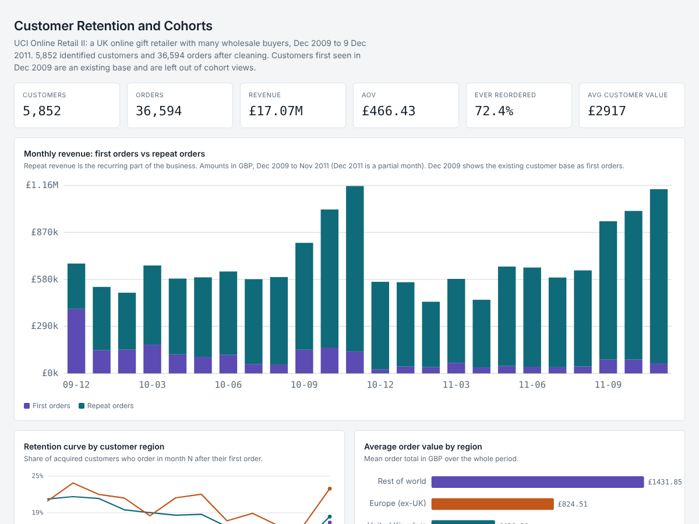

# Data Analytics Portfolio

Three business analytics projects on public datasets, each with SQL or Python code, a written result and a recommendation.
By Rand Ayad. www.linkedin.com/in/randayad · rand.al-khdhairawi@gmx.de

Interactive dashboards: https://rand-al-khdhairawi.github.io/data-analytics-portfolio/

## Projects

| # | Project | Business question | Main result |
|---|---|---|---|
| 1 | [Customer retention and cohorts](01-retail-retention-cohort-analysis/) | Where do customers drop off, and what drives repeat purchases and lifetime value? | 72% of customers reorder; 27% of customers (Champions) produce 70% of revenue; 28% never place a second order. |
| 2 | [A/B testing framework](02-ab-testing-framework/) | Did the ad campaign lift conversion, or is the difference noise? | Ads lift conversion by 0.77 percentage points (+43% relative, p about 1e-13), almost entirely among users who saw many ads. |
| 3 | [Supply chain delivery performance](03-supply-chain-logistics/) | Which routes and carriers cause delays, and how does lead-time variance affect targets? | On-time delivery is 42.7%. The 80/20 pattern follows order volume, and the cause is the promised delivery times per shipping mode. |



## Skills shown
- **SQL:** CTEs, window functions (`ROW_NUMBER`, `LAG`, running totals), date truncation, star schema design.
- **Python:** pandas, NumPy, SciPy, matplotlib, seaborn, unit tests, a Streamlit app.
- **Statistics:** sample ratio mismatch, chi-squared and z-tests, confidence intervals, power, multiple-testing correction, robustness checks.
- **Analytics:** RFM segmentation, cohort retention, Pareto analysis, KPI definition in SQL and DAX.
- **Communication:** decision memo, dashboards, stated limits for every result.

## Data
The datasets are not stored here. Each project's `data/README.md` says what to download and where to put it.

| Project | Dataset |
|---|---|
| 1 | Online Retail II (UCI Machine Learning Repository) |
| 2 | Marketing A/B Testing (Kaggle) |
| 3 | DataCo Smart Supply Chain (Mendeley Data) |

## Run any project on Windows
1. Install Python 3.12 or newer from python.org. Tick "Add python.exe to PATH" in the installer.
2. Open a terminal in this folder and create an environment:
```
py -m venv .venv
.venv\Scripts\activate
pip install -r requirements.txt
```
3. Open the project folder, put the data in `data\`, and follow that project's README.

If PowerShell blocks the activate script, run `Set-ExecutionPolicy -Scope CurrentUser RemoteSigned` once, or use Command Prompt instead.

## Limits worth knowing
- Project 1 has no marketing channel or product category in the data. Customer region and keyword-derived product families stand in for them.
- Project 3's data looks simulated (each shipping mode has the same delay every time), so it demonstrates the method more than real carrier behavior.
- The Power BI measures in Project 3 (`04_measures.dax`) have not been run in Power BI Desktop.
- The Project 2 Streamlit app has not been launched.
